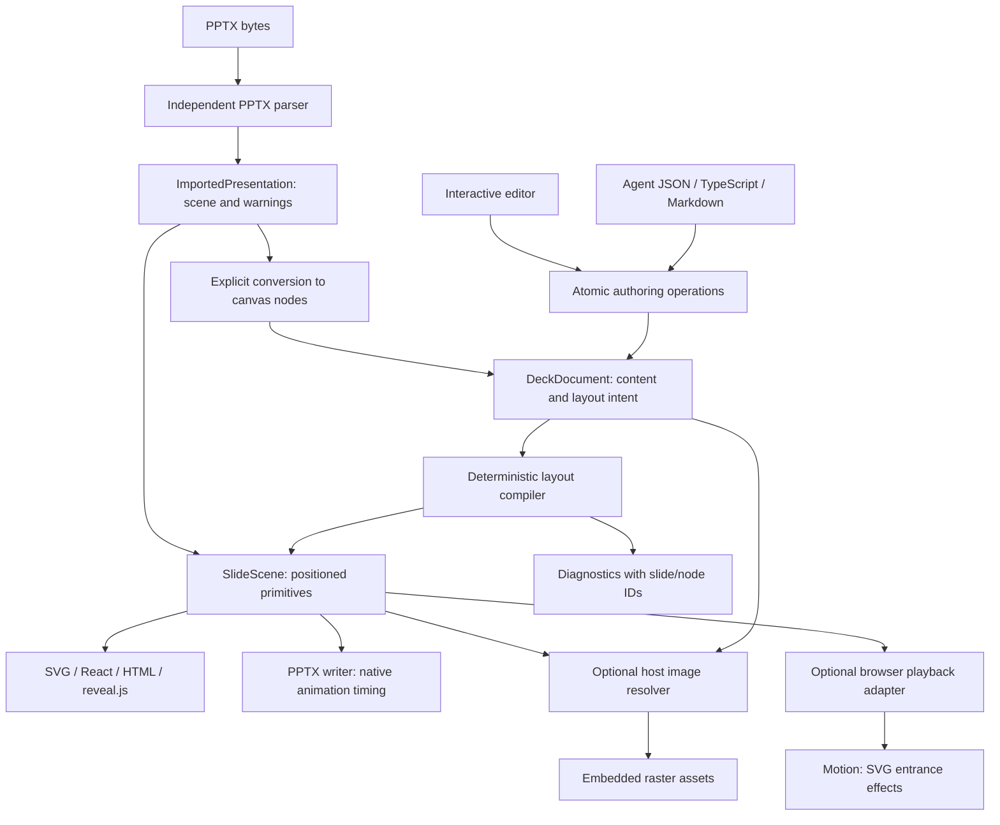

# Architecture

## Source and output

`DeckDocument` is versioned JSON containing semantic nodes, stable IDs, notes, themes, assets and layout intent. `stack`, `row`, `grid` and `canvas` are ordinary containers. Presets and user-defined component functions expand to these nodes before validation; they do not require a rendering framework or executable document code.

`SlideScene` contains positioned text, shape, image and table primitives. Text includes measured lines and line height. Compilation is pure and deterministic given the document and explicit font metrics. Renderers and export adapters consume scenes rather than making their own semantic layout decisions.

Imported PPTX produces `ImportedPresentation`: a scene, warnings and a list of source part names. The parser never depends on authoring or layout. `engine.importScene` deliberately produces editable canvas nodes with imported frames; it does not infer semantic layouts. Canonical export writes supported content into a fresh package. Original parts and unsupported features are not losslessly preserved.

## Ownership

| Owner           | Why it exists                                                                                          |
| --------------- | ------------------------------------------------------------------------------------------------------ |
| `lipat-model`   | One shared native/WASM contract and invariant boundary for documents/scenes                            |
| `lipat-author`  | Atomic candidate construction and document operations, independent of UI                               |
| `lipat-layout`  | Deterministic positioning, wrapping and diagnostics with explicit font inputs                          |
| `lipat-pptx`    | ZIP, relationships and PresentationML translation isolated from semantic creation                      |
| `lipat-wasm`    | A small JSON/byte ABI calling those exact crates, plus native CLI and schema generation                |
| TypeScript core | Subscriptions, bounded undo/redo, revisions and transient navigation; no duplicate layout/parser logic |
| React           | Browser interactions, rendering and subscription lifetimes                                             |
| Render/reveal   | Format-specific presentation output without changing source documents                                  |
| Images          | Explicit asynchronous URL resolution and immutable embedding with host-provided network capability     |
| Agent           | Framework-neutral tool schemas, compact outlines and tool argument handling                            |

A shared parser/compiler in JavaScript and Rust was considered and rejected: it would duplicate behavior and weaken cross-platform guarantees. The TypeScript facade requires explicit engine initialization instead. Public TypeScript contracts mirror the Rust wire types; native-generated JSON schemas and native/WASM equivalence tests guard the serialized boundary.

## Transactions and state

Each operation batch edits a candidate document, validates the complete candidate and commits once. Invalid batches, stale expected revisions and no-op edits do not change document history. A real edit increments revision once and notifies once. Undo/redo use immutable snapshots, bounded to 100 entries by default. Editing after undo clears redo.

Slide navigation and node selection are transient. Preview navigation is local to the preview. Providers do not dispose runtimes; the host owns runtimes and engines. Importing any entrypoint does not initialize WASM, access files, start timers or load CSS.

## Limits and portability

Coordinates are points, 72 per inch. Document nodes have globally unique IDs, with at most 64 levels and 100,000 nodes. Version 1 is the supported source/scene format. File/asset/ZIP/XML limits are checked before decompression or layout where possible. The core has no network, filesystem, DOM, font discovery or ambient clock dependency.

Font metrics are explicit. The fallback is deterministic and warned, not a guarantee of browser/PowerPoint pixel equivalence. PDF generation belongs to a browser/print host and is not implemented inside WASM.

## Identity ergonomics

Wire identities remain strings in the TypeScript authoring contract so agents can generate plain JSON and preset functions can produce predictable IDs. Operations use named `nodeId`, `slideId` and `assetId` fields, and the native boundary validates uniqueness, references and target kinds. This is an intentional trade-off against nominally branded IDs in the public authoring input.

## Animation boundary

Entrance effects are serializable leaf-node instructions validated in Rust and carried into scenes. `SlidePlaybackDriver<Surface>` defines the lifecycle without importing a browser or animation library. The optional `/motion` adapter owns SVG transforms, timing, cancellation and reduced motion; React owns navigation and mounting. The static renderer and reveal adapter already own their output formats, so importing Motion into either would impose a browser/runtime dependency on headless consumers. A separate adapter keeps that dependency optional and supports vanilla browser hosts. The independent native PPTX adapter translates the same portable instructions into PresentationML timing, without importing Motion. Easing approximations are reported. See [animations](./animations.md).

## Image boundary

Image source is a union of embedded asset identity and an HTTP(S) URL, validated in Rust. URL parsing, linked PPTX relationships and scene compilation need no network. A host-supplied `ImageLoader` owns fetch, byte limits and errors in the optional `/images` module. The synchronous engine cannot own browser/Node credentials, redirects, CORS or asynchronous I/O; keeping resolution separate lets native and WASM callers share one deterministic core. Resolution returns a new validated document or scene, preserving source state on failure.

## Host initialization and immutable viewing

The WASM adapter owns ABI validation, request/response memory and typed Results. Byte compilation and precompiled-module construction feed that same implementation; copying the bridge into a Worker was rejected because it duplicates ownership and breaks SDK parity. The precompiled module argument is structurally an object at the public type boundary, matching host `WebAssembly.Module` values without adding DOM declarations to headless consumers. Native instantiation and ABI checks establish the runtime capability.

`ScenePreview` and `ScenePlayer` own immutable scene navigation/rendering without an authoring dependency. Runtime-based viewers compile once per document revision and delegate to them. Keeping scene presentation separate from the runtime wrappers avoids reconstructing authoring documents for stored artifacts. Image-resource policy belongs to the shared SVG renderer, so React, HTML and reveal output enforce the same restriction.

`ResourceLimits` belongs to the native model. It is supplied explicitly to document validation, operations, layout and PPTX parsing; native/WASM requests use the same bounds. The private PPTX package context carries its limits into XML/relationship readers, preventing an inherited or auxiliary XML part from silently bypassing the host budget. There is no thread-local/global limit policy and no duplicate JavaScript layout/parser. See [limits](./limits.md).

## Editor sessions and native mobile

The headless editor session owns asynchronous save/image task lifetimes, cancellation and unsaved-snapshot tracking. The runtime remains the sole owner of documents, revisions and atomic history. Reusing only the previous text inspector would duplicate this task coordination in browser/native hosts; the session makes those semantics shared without owning a database or network client. Host callbacks are capabilities, not storage-specific Adapters.

WASM and native mobile transports share one JSON/byte protocol implementation in the internal engine package. WASM owns memory-buffer allocation; the optional native add-on owns Expo/Swift/Kotlin/JNI and pointer-sized Rust ABI mechanics. Copying the WASM bridge into a mobile host was rejected because Hermes need not implement WebAssembly and 64-bit pointers cannot use its packed WASM32 ABI. Native scenes share SVG rendering/image policy, while UI and playback mechanics stay platform-specific.

The optional native package carries platform binaries and autolinking metadata. The main package retains isolated model/core/web/Worker entrypoints and optional native UI peers. This split prevents iOS/Android static libraries from inflating every browser/Worker install.
