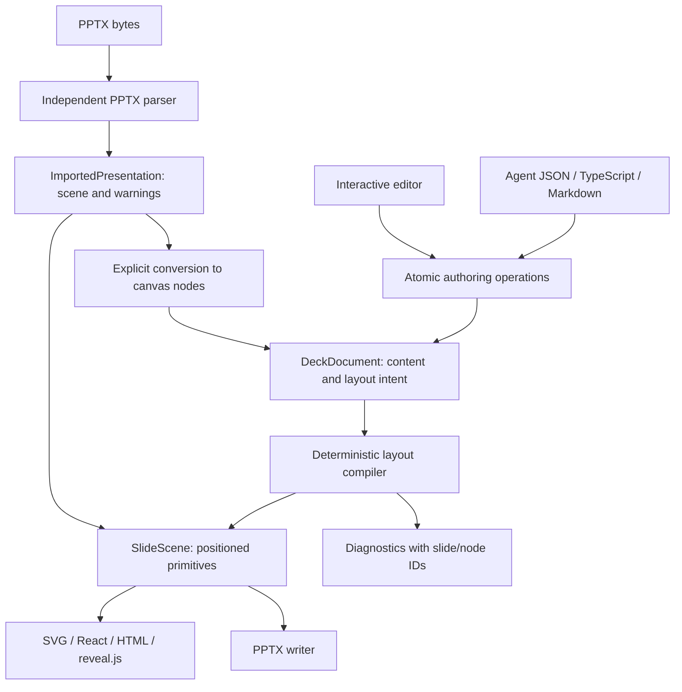

# Architecture

## Source and output

`DeckDocument` is versioned JSON containing semantic nodes, stable IDs, notes, themes, assets and layout intent. `stack`, `row`, `grid` and `canvas` are ordinary containers. Presets and user-defined component functions expand to these nodes before validation; they do not require a rendering framework or executable document code.

`SlideScene` contains positioned text, shape, image and table primitives. Text includes measured lines and line height. Compilation is pure and deterministic given the document and explicit font metrics. Renderers and export adapters consume scenes rather than making their own semantic layout decisions.

Imported PPTX produces `ImportedPresentation`: a scene, warnings and a list of source part names. The parser never depends on authoring or layout. `engine.importScene` deliberately produces editable canvas nodes with imported frames; it does not infer semantic layouts. Canonical export writes supported content into a fresh package. Original parts and unsupported features are not losslessly preserved.

## Ownership

| Owner           | Why it exists                                                                                          |
| --------------- | ------------------------------------------------------------------------------------------------------ |
| `lipat-model`   | One shared native/WASM contract and invariant boundary for documents/scenes                            |
| `lipat-author`  | Atomic candidate construction and document operations, independent of UI                               |
| `lipat-layout`  | Deterministic positioning, wrapping and diagnostics with explicit font inputs                          |
| `lipat-pptx`    | ZIP, relationships and PresentationML translation isolated from semantic creation                      |
| `lipat-wasm`    | A small JSON/byte ABI calling those exact crates, plus native CLI and schema generation                |
| TypeScript core | Subscriptions, bounded undo/redo, revisions and transient navigation; no duplicate layout/parser logic |
| React           | Browser interactions, rendering and subscription lifetimes                                             |
| Render/reveal   | Format-specific presentation output without changing source documents                                  |
| Agent           | Framework-neutral tool schemas, compact outlines and tool argument handling                            |

A shared parser/compiler in JavaScript and Rust was considered and rejected: it would duplicate behavior and weaken cross-platform guarantees. The TypeScript facade requires explicit engine initialization instead. Public TypeScript contracts mirror the Rust wire types; native-generated JSON schemas and native/WASM equivalence tests guard the serialized boundary.

## Transactions and state

Each operation batch edits a candidate document, validates the complete candidate and commits once. Invalid batches, stale expected revisions and no-op edits do not change document history. A real edit increments revision once and notifies once. Undo/redo use immutable snapshots, bounded to 100 entries by default. Editing after undo clears redo.

Slide navigation and node selection are transient. Preview navigation is local to the preview. Providers do not dispose runtimes; the host owns runtimes and engines. Importing any entrypoint does not initialize WASM, access files, start timers or load CSS.

## Limits and portability

Coordinates are points, 72 per inch. Document nodes have globally unique IDs, with at most 64 levels and 100,000 nodes. Version 1 is the supported source/scene format. File/asset/ZIP/XML limits are checked before decompression or layout where possible. The core has no network, filesystem, DOM, font discovery or ambient clock dependency.

Font metrics are explicit. The fallback is deterministic and warned, not a guarantee of browser/PowerPoint pixel equivalence. PDF generation belongs to a browser/print host and is not implemented inside WASM.

## Identity ergonomics

Wire identities remain strings in the TypeScript authoring contract so agents can generate plain JSON and preset functions can produce predictable IDs. Operations use named `nodeId`, `slideId` and `assetId` fields, and the native boundary validates uniqueness, references and target kinds. This is an intentional trade-off against nominally branded IDs in the public authoring input.
